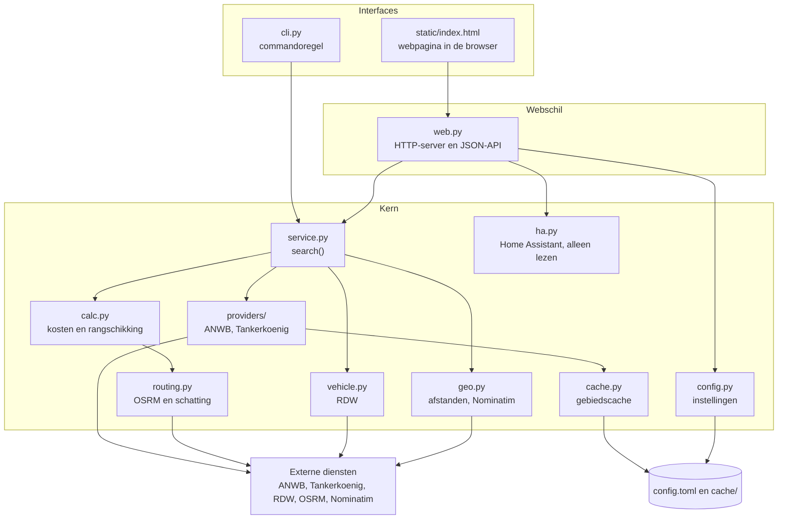
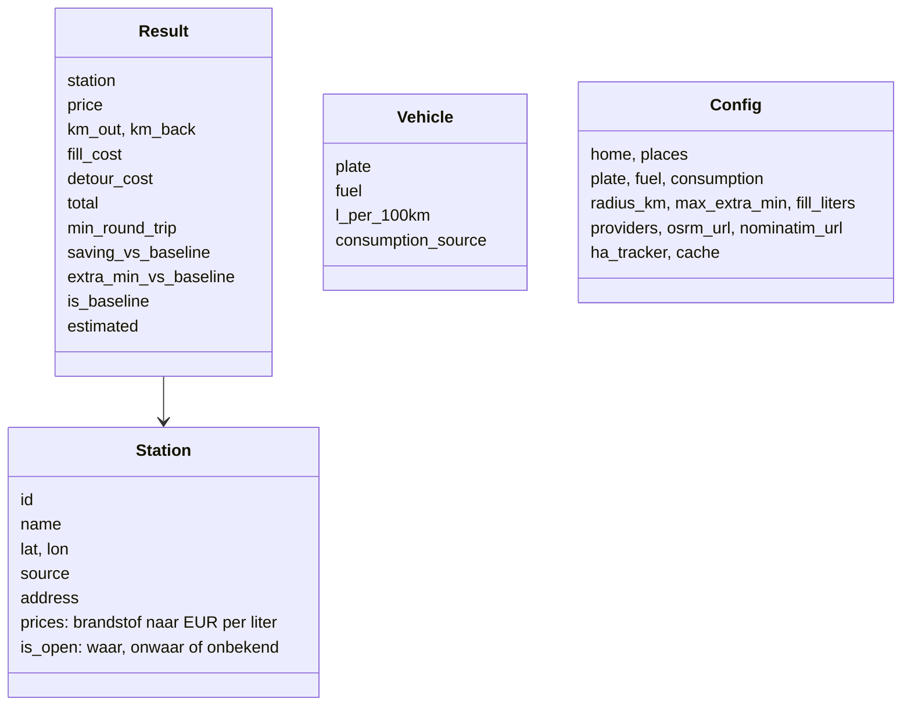
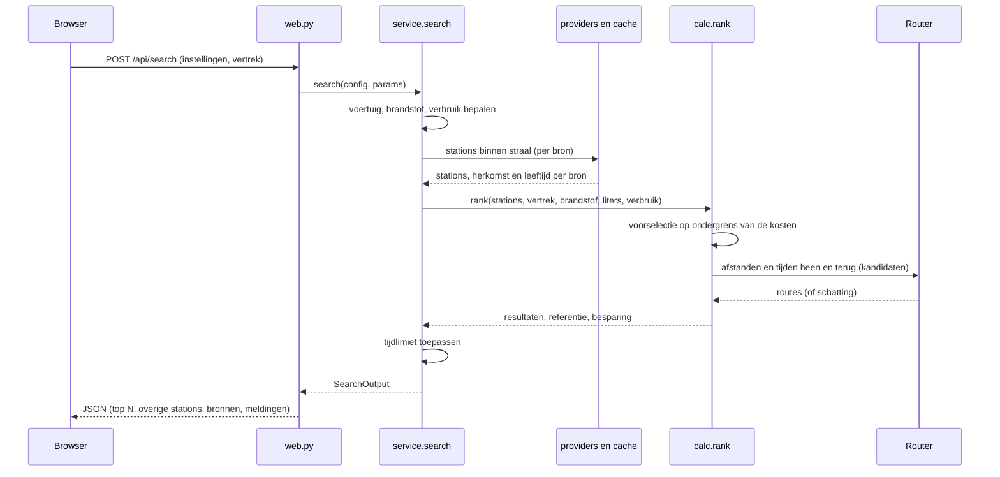
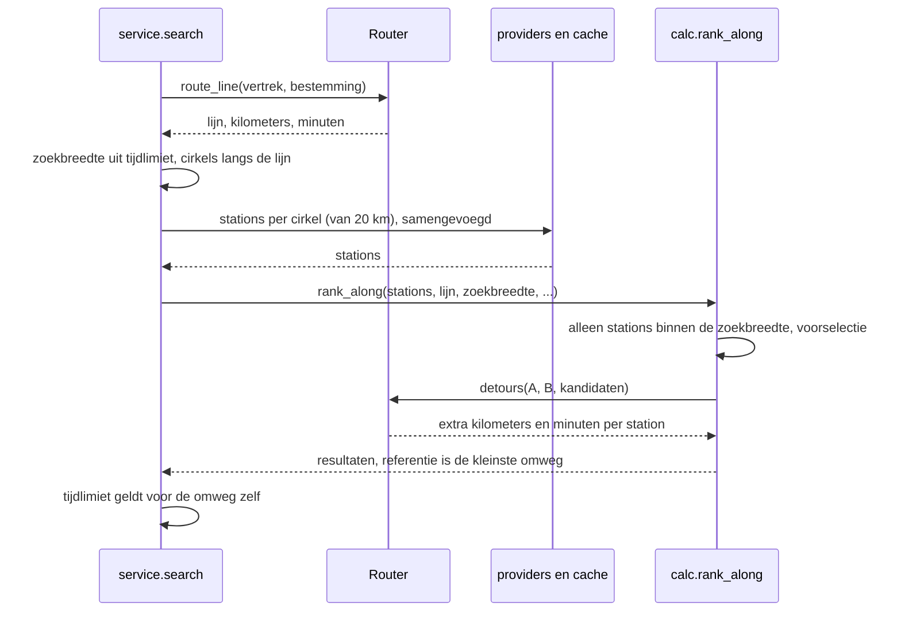
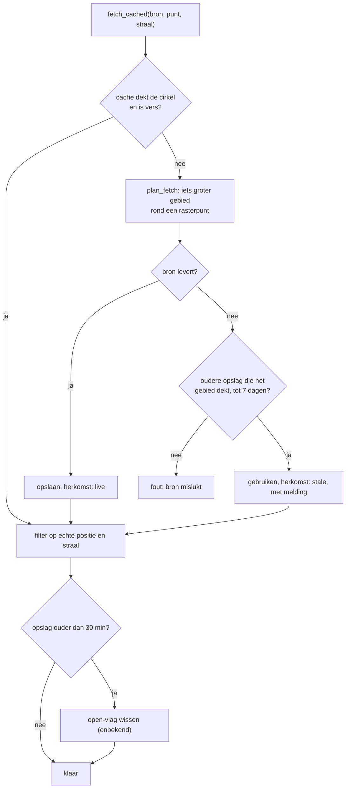
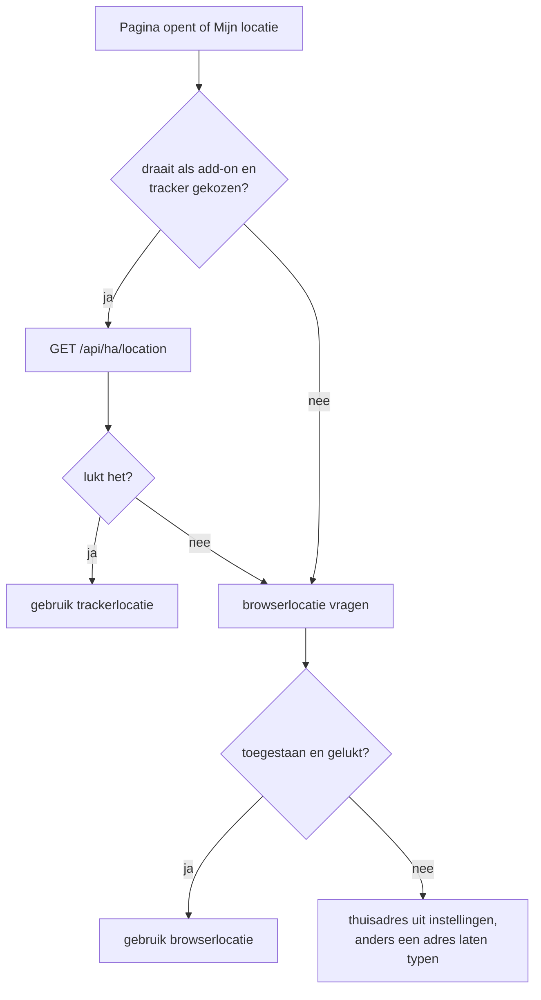
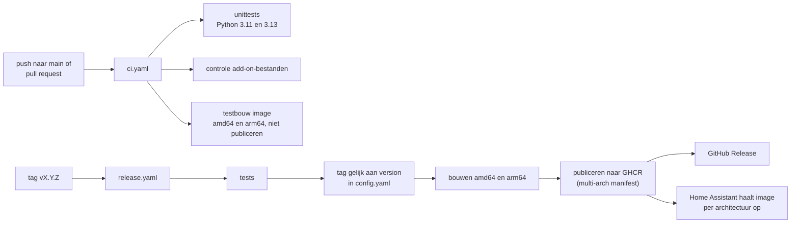

# Goedkoop tanken: ontwerp

Dit document legt uit **hoe** de app is opgebouwd en **waarom** er voor deze oplossing is gekozen. Het **wat** staat in
[REQUIREMENTS.md](REQUIREMENTS.md). Elke ontwerpkeuze (D-nummer) verwijst naar de eisen die hij invult (FR- en NFR-nummers),
en hoofdstuk 9 geeft de omgekeerde tabel: per eis de keuzes, modules en tests.

**Leeswijzer.** Hoofdstuk 2 en 3 geven het overzicht en de mappenstructuur. Hoofdstuk 4 beschrijft de gegevens. Hoofdstuk 5
werkt elke flow uit. Hoofdstuk 6 en 7 gaan over beveiliging en de draaiomgevingen. Hoofdstuk 8 bevat de ontwerpkeuzes met
redenen en afgewezen alternatieven.

**Herkomst van besluiten.** Per keuze staat wie hem nam: *Jeroen* (hij besliste of vroeg erom) of *Claude*
(ontwerpkeuze tijdens het bouwen). Alternatieven zijn alleen opgenomen als ze echt overwogen zijn.

## 1. Uitgangspunten

- Eén kern met alle logica, los van de interface. De commandoregel, de webinterface en de add-on gebruiken dezelfde kern.
- Alleen de Python-standaardbibliotheek (Python 3.11 of nieuwer); geen pakketten om te installeren.
- Eén webpagina zonder bouwstap, met meegeleverde kaartbibliotheek (Leaflet).
- Dezelfde code draait op de laptop (`python -m fuelfinder web`) en in Home Assistant achter Ingress.

## 2. Architectuur

De pijlen gaan van boven naar beneden: de kern kent de interfaces niet. De kaarttegels (OpenStreetMap) haalt de browser zelf op.

## 3. Projectstructuur

| Pad | Verantwoordelijkheid |
| --- | --- |
| `fuelfinder/service.py` | `search()`: de hele zoekopdracht in één functie; `export_data()`, `test_source()`; bepaalt de zoekgebieden langs een route |
| `fuelfinder/calc.py` | Kosten per station (`rank`, `rank_along`), voorselectie, referentiestation, tijdlimiet |
| `fuelfinder/routing.py` | `Router`: rijafstand en rijtijd via OSRM, met terugval op een schatting |
| `fuelfinder/providers/` | Prijsbronnen: `base.py` (contract), `anwb.py`, `tankerkoenig.py`, `__init__.py` (register, samenvoegen, ontdubbelen) |
| `fuelfinder/cache.py` | Cache per gebied met raster, houdbaarheid en terugval op oude gegevens |
| `fuelfinder/vehicle.py` | Kenteken naar brandstof en verbruik via RDW open data |
| `fuelfinder/geo.py` | Afstanden, adres opzoeken en omgekeerd (Nominatim, met snelheidslimiet), punten langs een lijn |
| `fuelfinder/config.py` | `Config`, laden en opslaan van TOML, validatie, vaste adressen |
| `fuelfinder/http.py` | Eén HTTP-functie voor alles (`fetch_json`), met herpogingen en een snelle testmodus |
| `fuelfinder/ha.py` | Alleen-lezen koppeling met Home Assistant (trackerlijst en trackerlocatie) |
| `fuelfinder/web.py` | `App` (acties, testbaar zonder HTTP), `serialize()`, en de HTTP-handler met beveiliging |
| `fuelfinder/cli.py` | Commando's `find`, `stations`, `vehicle`, `check`, `cache`, `web` |
| `fuelfinder/models.py` | `Station`, `Vehicle`, `Result`, brandstofnamen |
| `fuelfinder/static/index.html` | De hele webinterface (HTML, CSS en JavaScript in één bestand) |
| `fuelfinder/static/vendor/leaflet/` | Meegeleverde kaartbibliotheek (Leaflet 1.9.4) |
| `goedkoop-tanken/` | Home Assistant-add-on: `config.yaml`, `Dockerfile`, startscripts, documentatie, vertaling |
| `repository.yaml` | Maakt de repository herkenbaar als add-on-opslagplaats |
| `.github/workflows/` | `ci.yaml` (testen en testbouw), `release.yaml` (bouwen en publiceren bij een tag) |
| `scripts/` | `lokale-addon.sh` (add-on lokaal testen), `check_addon.py` (controle in CI) |
| `tests/` | Offline tests met nagebootste bronnen |
| `docs/` | Dit document en de requirements |

## 4. Gegevens

- **Brandstoffen** hebben vaste namen (`petrol95`, `petrol98`, `diesel`, `lpg`); elke bron vertaalt zijn eigen namen daarnaartoe.
- **Bij een route** betekent `km_out` het aantal extra kilometers en `min_round_trip` de extra minuten; `km_back` is dan 0. Daardoor rekent de rest van het programma voor beide modi hetzelfde (D-7).
- **Bedragen** worden op hele centen afgerond op het moment dat ze berekend worden, zodat wat getoond wordt onderling klopt: totaal is tank plus omrit, besparing is het verschil van twee totalen.
- **Vaste adressen** zijn een lijst `{name, address, lat, lon}`; naam is verplicht en uniek (hoofdlettergevoelig niet), maximaal 20.

## 5. Flows

### 5.1 Zoeken rond een punt

1. Vertrek komt uit coördinaten of een adres (Nominatim). Brandstof en verbruik komen uit het kenteken (RDW), tenzij de gebruiker ze zelf invult. Het praktijkverbruik is het officiële verbruik maal een factor (standaard 1,2), behalve bij een zelf opgegeven verbruik.
2. Elke ingeschakelde bron levert stations binnen de straal (zie 5.3). Stations binnen 75 m van een station van een andere bron tellen eenmaal; de bron die eerder in de lijst staat wint.
3. De rekenkern berekent per station `tank = liters × prijs`, `omrit = (km heen + km terug) × verbruik / 100 × prijs` en `totaal = tank + omrit`.
4. Voorselectie: eerst een ondergrens per station op hemelsbrede afstand; de beste 40 plus de 3 dichtstbijzijnde gaan door naar de routeserver. Zo blijft het aantal aanvragen klein.
5. Het referentiestation is het station met de kleinste rijafstand. Besparing en extra tijd zijn het verschil met dit station.
6. De tijdlimiet haalt stations weg waarvan de extra rijtijd ten opzichte van de referentie te groot is. De referentie blijft altijd staan.
7. `serialize()` maakt van de uitkomst JSON: de top N, het referentiestation, en de overige doorgerekende stations (voor de grijze stippen op de kaart).

### 5.2 Zoeken langs een route

- **Zoekbreedte**: standaard 0,4 km per toegestane minuut omweg, begrensd tussen 3 en 15 km (zonder limiet 10 km). Reden: een zijstap van d km kost ongeveer 2d km rijden.
- **Zoekgebieden**: cirkels met een straal van 20 km langs de route, op een afstand van elkaar die uit de zoekbreedte volgt (`stap = 2 × √(r² − breedte²)`, met een marge van 1,1 voor bochten). Maximaal 20 cirkels, ruim 600 km route.
- **Omweg**: voor elk station `(A naar station) + (station naar B) − (A naar B)`. Dat gaat in twee aanvragen aan de routeserver voor alle kandidaten tegelijk (D-7).
- **Maximale afstand** (optioneel): stations met een rijafstand vanaf het vertrek boven de grens vallen af voordat de referentie wordt bepaald (D-24).
- **Bestemming** komt uit coördinaten, een adres, of de naam van een vast adres. Een lege bestemming betekent het vaste adres "Werk", als dat bestaat; anders volgt een foutmelding (5.6).
- **Vertrek en bestemming bijna gelijk** (minder dan 0,3 km): foutmelding, met de verwijzing naar zoeken rond een punt.

### 5.3 Prijsbronnen en cache

- Een bron levert alleen stations binnen een straal; Tankerkönig staat maximaal 25 km toe. Bij een misser haalt de cache een iets groter gebied op rond een rasterpunt (0,05 graad), zodat een volgende zoekopdracht vanaf een iets andere plek weer een treffer is.
- Een treffer is een opgeslagen cirkel die de hele zoekcirkel dekt en vers genoeg is (standaard 12 uur).
- Per bron zijn er maximaal 12 opslagen; een oudere opslag die volledig binnen een nieuwe valt, verdwijnt.
- Schrijven gaat atomair (tijdelijk bestand, dan vervangen). Kan de cache niet schrijven, dan werkt de app zonder cache verder.
- **ANWB**: een kader (bounding box) per aanvraag; geeft de API `limit_exceeded`, dan wordt het kader in vieren gesplitst, tot drie niveaus diep.
- **Tankerkönig**: één aanvraag per gebied, met API-sleutel. De sleutel komt uit de omgevingsvariabele `TANKERKOENIG_API_KEY` of uit `config.toml`; de omgevingsvariabele wint.

### 5.4 Kenteken, brandstof en verbruik

1. `vehicle.lookup()` vraagt twee RDW-datasets op (brandstof en basisgegevens).
2. Het verbruik komt uit de WLTP-waarde als die er is, anders NEDC.
3. Een zelf ingevulde brandstof of verbruik overschrijft de RDW. Een zelf opgegeven verbruik is al een praktijkwaarde en krijgt geen factor.
4. Lukt het opzoeken niet, dan komt er een waarschuwing en gaat de zoekopdracht verder als brandstof en verbruik elders bekend zijn.

### 5.5 Instellingen

- `App` in `web.py` houdt het pad van `config.toml` vast. Elke aanvraag laadt de instellingen opnieuw (geen toestand in het geheugen, behalve de laatste uitkomst voor de export).
- **Opslaan**: de browser stuurt alle velden; `config.from_dict()` valideert en begrenst waarden. Een leeg sleutelveld laat de bestaande sleutel staan. Een aanvraag zonder `places` laat de opgeslagen vaste adressen staan.
- **Schrijven**: naar een tijdelijk bestand met rechten 0600, dan atomisch vervangen. De sleutel staat in het bestand, maar de API geeft hem nooit terug; alleen de herkomst ("config", "env" of "none").
- **Zoeken met niet-opgeslagen instellingen**: de pagina stuurt bij elke berekening de huidige formulierwaarden mee, en het vertrekpunt van die berekening is de huidige locatie, niet per se het thuisadres.
- **Oude bestanden**: een `[work]`-blok wordt bij het laden het vaste adres "Werk".

### 5.6 Vaste adressen en bestemming

- Het menu bevat een lijst met rijen (naam, adres, coördinaten). Een rij kan worden gevuld door een adres te typen en op **Zoek** te klikken, of via **Kies op kaart**.
- Bij **Kies op kaart** opent dezelfde kaartdialoog als bij de bestemming. Na de keuze worden de coördinaten ingevuld; het adresveld wordt alleen gevuld als het leeg was (reverse geocoding).
- De keuzelijst bij de bestemming bevat eerst **Thuis** (als er een thuisadres is, en tenzij de gebruiker zelf een adres "Thuis" heeft), daarna de vaste adressen.
- Een gekozen adres met coördinaten wordt als punt verstuurd; zonder coördinaten wordt het adres bij het berekenen opgezocht.
- Op de server werkt `resolve_destination()` met de volgorde: meegestuurde coördinaten, naam van een vast adres (leeg of "work" geeft "Werk"), coördinaten als tekst, adres via Nominatim.

### 5.7 Resultaten, kaart en inzicht

- **Tabel en kaartjes**: dezelfde regels (`<tr>`) worden op een breed scherm als tabel getoond en tot 700 px breed met CSS als kaartje (D-18).
- **Kaart**: route, vertrekpunt, bestemming, genummerde stations en grijze stippen voor doorgerekende stations die niet in de tabel staan. Een klik op een regel, pin of stip selecteert het station.
- **Berekening per station**: een paneel toont stap voor stap hoe totaal en besparing zijn berekend. De omweg via dat station wordt apart opgehaald (`/api/via`: route vertrek, station, bestemming) en op de kaart getekend.
- **Herkomst**: elk station toont zijn bron en of de gegevens vers of uit de cache zijn, met leeftijd.
- **Export**: `/api/export` geeft de laatste berekening als JSON-download: alle bekeken stations, per station de status (getoond, weggelaten door de tijdlimiet, buiten de zoekbreedte, geen prijs, gesloten, niet doorgerekend, dubbel), het nummer `nr` en `on_screen` ("tabel en kaart", "alleen kaart").

### 5.8 Locatie

- `ha.py` doet alleen twee leesaanroepen naar Home Assistant: de lijst met `device_tracker`-entiteiten met een locatie, en de locatie van de gekozen tracker. Het token (`SUPERVISOR_TOKEN`) komt uit de omgeving en verschijnt nooit in logs of antwoorden.
- De trackerkeuze staat in de instellingen en verschijnt alleen als de app als add-on draait.

### 5.9 Bronnen testen

- De testknop roept `service.test_source()` aan: één poging met een korte time-out (`http.quick()`), op een vast klein gebied (Kleve voor Tankerkönig, Roermond voor ANWB).
- Een ingevulde maar nog niet opgeslagen sleutel wordt gebruikt voor de test.
- Het antwoord noemt het aantal stations, de duur en bij een fout een advies: geen sleutel, sleutel geweigerd, time-out, of verbindingsfout. De sleutel wordt uit foutmeldingen gehaald.

## 6. Beveiliging

| Onderdeel | Aanpak |
| --- | --- |
| Luisteradres | Laptop: alleen 127.0.0.1. Add-on: alle adressen, maar zie hieronder |
| Laptop | De `Host`-header moet een lokaal adres zijn (tegen DNS-rebinding); POST's moeten JSON zijn met een `Origin` die bij de server hoort (tegen aanvragen van andere sites) |
| Add-on (Ingress) | Alleen verkeer van de Supervisor (172.30.32.2, plus 127.0.0.1) wordt geaccepteerd; de Host- en Origin-controle vervalt omdat Home Assistant die bepaalt. Home Assistant zorgt voor de inlog |
| Contentbeleid | `default-src 'self'`; scripts en stijlen van de pagina zelf; afbeeldingen van de pagina, `data:` en `tile.openstreetmap.org`; geen CDN |
| Referer | `Referrer-Policy: origin`, en per kaarttegel de herkomst meesturen (OSM weigert tegels zonder Referer) |
| Vendor-bestanden | Alleen vooraf bekende bestanden in de vendor-map worden geserveerd, op exacte namen; geen pad om uit de map te ontsnappen |
| Sleutel | Nooit in antwoorden, export of logs; bestand met rechten 0600; niet in de repository (`.gitignore`) |
| Home Assistant | Alleen lezen, twee aanroepen; geen schrijfrechten gebruikt |
| Invoer | Alle instellingen worden gevalideerd en begrensd; body maximaal 100 kB; DOM wordt met een veilige bouwer opgebouwd (tekst wordt nooit als HTML ingevoegd) |

## 7. Draaiomgevingen

| | Laptop | Home Assistant-add-on |
| --- | --- | --- |
| Start | `python -m fuelfinder web` | s6-service `goedkoop-tanken` in de container |
| Adres | `127.0.0.1:8080`, opent de browser | `0.0.0.0:8099`, alleen via Ingress |
| Instellingen | `config.toml` in de map | `/data/config.toml` (blijft bij updates) |
| Cache | `cache/` naast `config.toml` | `/data/cache/` |
| Locatie | Browser | HA-tracker, met de browser als reserve |
| Beveiliging | Host- en Origin-controle | Alleen de Supervisor |

**Container.** Het `Dockerfile` begint bij `ghcr.io/home-assistant/base`, installeert Python via `apk` en kopieert de map `fuelfinder/` plus de startscripts. De bouwcontext is de hoofdmap van de repository. Het startscript (`#!/command/with-contenv bashio`) leest de optie `contact`, zet `FUELFINDER_CONTACT` voor de User-Agent en start de webserver met `--host 0.0.0.0 --port 8099 --data-dir /data --ingress --no-browser`.

**Ingress en paden.** Home Assistant serveert de pagina onder een pad als `/api/hassio_ingress/<token>/`. Daarom gebruikt de pagina alleen relatieve URL's (`api/...`, `vendor/...`).

### 7.1 Bouwen en uitbrengen

- Een gewone push maakt nooit een release; alleen een tag `vX.Y.Z` doet dat.
- De imagenaam is `ghcr.io/<eigenaar>/goedkoop-tanken`, los van de naam van de repository.
- Home Assistant ziet een update zodra `version` in `config.yaml` hoger is dan de geïnstalleerde versie.
- `scripts/lokale-addon.sh` maakt een map om de add-on lokaal te testen op Home Assistant zonder GHCR (de Supervisor bouwt dan zelf).
- `.gitattributes` houdt de startscripts, het `Dockerfile` en YAML-bestanden op LF-regeleinden, ook op Windows.

## 8. Ontwerpbeslissingen

Elke beslissing heeft een context, een keuze, redenen en afgewezen alternatieven, plus de eisen die hij invult.

### D-1. Eén zoekfunctie, los van de interface

- **Besluit door:** Claude. **Eisen:** FR-1, FR-8, NFR-1, FR-27.
- **Keuze:** alle logica die niet over uiterlijk gaat staat in `service.search()` en geeft een `SearchOutput` terug. CLI, web en add-on roepen die functie aan.
- **Reden:** zo delen de commandoregel, de webinterface en een latere app of Home Assistant-koppeling dezelfde logica. De laptop en de add-on gedragen zich daardoor hetzelfde.
- **Afgewezen:** logica in de webhandlers. Dat zou de commandoregel en testen zonder HTTP onmogelijk maken.

### D-2. Alleen de standaardbibliotheek

- **Besluit door:** Claude. **Eisen:** NFR-1, NFR-2.
- **Keuze:** geen externe pakketten; de webserver is `http.server`, HTTP is `urllib`.
- **Reden:** gebruikers hoeven geen pakketten te installeren, en de container blijft klein.
- **Afgewezen:** een webframework en een HTTP-bibliotheek. Ze zouden installatie en onderhoud van afhankelijkheden vragen. Een nadeel van de gekozen route is meer eigen code voor routering, beveiliging en validatie.

### D-3. Prijsbronnen als losse providers

- **Besluit door:** Claude. **Eisen:** FR-2, FR-24.
- **Keuze:** elke bron is een klasse met `fetch(lat, lon, straal)` in één bestand, geregistreerd in `providers/__init__.py`. Elke bron vertaalt zijn eigen brandstofnamen naar vaste namen.
- **Reden:** een nieuwe bron toevoegen is één bestand plus één regel.
- **Afgewezen:** bronnen rechtstreeks in de zoeklogica opnemen.
- **Risico (O-6):** de ANWB-bron is geen officiële API (zie de toelichting in `providers/anwb.py`) en kan wijzigen of verdwijnen. Door deze keuze is een vervangende bron één nieuw bestand; of de DirectLease TankService een geschikte vervanger is, is niet onderzocht.

### D-4. Kostenmodel: totaal en referentie

- **Besluit door:** Jeroen (wens), Claude (uitwerking). **Eisen:** FR-1, FR-6.
- **Keuze:** `totaal = liters × prijs + omrit`, waarbij de brandstof voor de omrit tegen de prijs van het station zelf wordt gerekend. De besparing is relatief aan het dichtstbijzijnde station (rond een punt) of het station met de kleinste omweg (langs een route).
- **Reden:** dat is wat je zonder zoeken zou doen. De brandstof voor de rit wordt tegen de prijs van het station zelf gerekend; het verschil met je eigen tankinhoud is verwaarloosbaar.
- **Afgewezen:** sorteren op literprijs (negeert de omrit, het hele doel van de app) en besparing ten opzichte van een gemiddelde (minder herkenbaar).

### D-5. Voorselectie voor de routeserver

- **Besluit door:** Claude. **Eisen:** FR-1, NFR-10, NFR-15.
- **Keuze:** eerst een ondergrens per station op hemelsbrede afstand; alleen de beste 40 (60 langs een route) plus de 3 dichtstbijzijnde gaan naar de routeserver.
- **Reden:** de publieke OSRM-server is bedoeld voor licht gebruik; de routering moet in twee aanvragen per zoekopdracht passen.
- **Afgewezen:** alle stations routeren. Dat zou de limieten van de openbare server raken.

### D-6. Routering via OSRM met een schatting als terugval

- **Besluit door:** Jeroen (OSRM), Claude (terugval). **Eisen:** FR-5, NFR-9, NFR-15.
- **Keuze:** de tabel-API van OSRM; bij uitval een schatting (1,3 × hemelsbreed, 50 km/u), duidelijk gemarkeerd met een tilde.
- **Reden:** een openbare, gratis dienst zonder sleutel. De server-URL is instelbaar; bij het bereiken van de limiet kan een eigen server worden gebruikt.
- **Afgewezen:** alleen hemelsbrede afstanden (te onnauwkeurig bij rivieren en grenzen) en een betaalde routeservice.

### D-7. Omweg als verschil van twee tabellen

- **Besluit door:** Claude. **Eisen:** FR-8, FR-9.
- **Keuze:** `omweg = (A naar station) + (station naar B) − (A naar B)`, uit twee tabelaanvragen (alles vanaf A, alles naar B). Het resultaat hergebruikt het bestaande `Result`: `km_out` is de extra afstand, `km_back` is 0.
- **Reden:** de hele rangschikking, besparing en weergave werkt dan voor beide modi zonder aparte code. Twee aanvragen dekken alle kandidaten.
- **Afgewezen:** per station een volledige route opvragen (veel aanvragen); een apart resultaattype voor routes (dubbele code in kern en UI).

### D-8. Zoekgebieden langs een route

- **Besluit door:** Claude. **Eisen:** FR-8, FR-9, FR-4.
- **Keuze:** cirkels van 20 km langs de routelijn; de zoekbreedte volgt uit de tijdlimiet.
- **Reden:** 20 km blijft ruim onder de 25 km die Tankerkönig toestaat, ook na de marge van de cache. Verder zoeken dan ongeveer 0,4 km per toegestane minuut heeft geen zin omdat een zijstap van d km ongeveer 2d km rijden kost.
- **Afgewezen:** één groot kader om de hele route (zou de limieten van de bronnen overschrijden en veel onnodige stations ophalen).

### D-9. Cache per gebied, niet per zoekopdracht

- **Besluit door:** Jeroen (wens voor lokale cache), Claude (uitwerking). **Eisen:** FR-7, NFR-9, NFR-10.
- **Keuze:** gebieden op een raster met een marge, geldig tot 12 uur, met terugval op oudere gegevens (tot 7 dagen) als een bron uitvalt, en een duidelijke melding.
- **Reden:** je positie verschilt bij elke berekening een beetje, zeker met een apparaatlocatie; een cache per exacte zoekopdracht zou dus bijna nooit raak zijn.
- **Afgewezen:** cache per zoekopdracht; geen cache (meer aanvragen bij de bronnen, en geen terugval bij uitval).

### D-10. De "open"-vlag vervalt bij oude gegevens

- **Besluit door:** Claude. **Eisen:** FR-7.
- **Keuze:** bij gegevens ouder dan 30 minuten wordt de open- of dicht-status genegeerd.
- **Reden:** een station dat 's middags open was, kan nu dicht zijn en andersom.

### D-11. Dubbele stations uit twee bronnen

- **Besluit door:** Claude. **Eisen:** FR-2, FR-18.
- **Keuze:** binnen 75 m van een station van een andere bron telt één station; de bron die eerder in de lijst staat wint. Weggelaten dubbelen staan in de export.
- **Reden:** ANWB (Nederland en België) en Tankerkönig (Duitsland) dekken samen de grensstreek; zonder ontdubbelen kan hetzelfde station twee keer in de uitkomst staan. De grens van 75 m is een praktische keuze.

### D-12. Instellingen in de app, in één TOML-bestand

- **Besluit door:** Jeroen (in de app zelf), Claude (formaat). **Eisen:** FR-23, NFR-11, NFR-12.
- **Keuze:** één bestand `config.toml` dat de webinterface leest en schrijft (laptop: in de map, add-on: in `/data`). Atomair schrijven met rechten 0600.
- **Reden:** Jeroen wil de instellingen in de app zelf beheren; hetzelfde bestand werkt op de laptop en in de add-on, en blijft bij updates bewaard.
- **Afgewezen:** instellingen in de Home Assistant-configuratiepagina. Alleen een technische optie (`contact`) staat daar.

### D-13. Vaste adressen als lijst

- **Besluit door:** Jeroen. **Eisen:** FR-13 tot FR-16.
- **Keuze:** een lijst `[[places]]` met naam, adres en optioneel coördinaten. "Werk" is de standaardbestemming; een oud `[work]`-blok wordt automatisch "Werk".
- **Reden:** Jeroen wilde meer dan thuis en werk, met vrij te kiezen namen.
- **Vervangen:** een eerdere versie had één vast werkadres. Dat is vervangen omdat het niet uitbreidbaar was; de migratie voorkomt dat bestaande bestanden stuk gaan.

### D-14. Eigen HTTP-server met strikte controles, en Ingress-modus

- **Besluit door:** Claude, Ingress door Jeroen. **Eisen:** FR-27, NFR-1, NFR-12.
- **Keuze:** op de laptop alleen 127.0.0.1 met Host- en Origin-controle; in de add-on alleen verkeer van de Supervisor. De app heeft geen eigen inlog.
- **Reden:** de server bewaart de API-sleutel en heeft geen inlog; op de laptop beschermt de Host/Origin-controle tegen aanvallen vanuit andere websites in de browser. In Home Assistant is de gebruiker al ingelogd en laat Ingress alleen ingelogd verkeer door.
- **Afgewezen:** een eigen inlog (dubbel met Home Assistant) en een openstaande poort op het netwerk (`ports:`-blok in de add-on).

### D-15. Eén pagina zonder bouwstap, met relatieve URL's

- **Besluit door:** Claude. **Eisen:** FR-27, NFR-7, NFR-8.
- **Keuze:** `static/index.html` met CSS en JavaScript, zonder framework of bundelaar. Alle verwijzingen zijn relatief.
- **Reden:** geen bouwstap in de container of CI; relatieve URL's zijn nodig omdat Ingress de pagina onder een pad serveert.
- **Nadeel:** het bestand is groot (ongeveer 1.100 regels). Het is bewust één bestand; een bouwstap kan later als het bestand moeilijk te onderhouden wordt.

### D-16. Leaflet meegeleverd, OSM-tegels met Referer

- **Besluit door:** Claude. **Eisen:** FR-10, FR-14, FR-17, NFR-13.
- **Keuze:** Leaflet 1.9.4 staat in de repository; de tegels komen van `tile.openstreetmap.org`. Elke tegel vraagt om de herkomst mee te sturen (`referrerPolicy: "origin"`), en de server stuurt `Referrer-Policy: origin`.
- **Reden:** geen externe scripts (strikt contentbeleid). OpenStreetMap gaf in Home Assistant een foutpagina (403) omdat er geen Referer werd meegestuurd; met de herkomst per tegel werkt de kaart, bevestigd door Jeroen.
- **Afgewezen (voorlopig):** de tegels via de add-on ophalen met een eigen User-Agent en een cache. Dat is robuuster maar meer werk; het blijft de terugval als OpenStreetMap het Referer-gedrag in de toekomst weigert.

### D-17. Locatie uit een HA-tracker, met de browser als reserve

- **Besluit door:** Jeroen. **Eisen:** FR-26, NFR-14.
- **Keuze:** de add-on leest de trackerlocatie via de Supervisor-API met twee leesaanroepen.
- **Reden:** de telefoon van Jeroen levert de locatie al aan Home Assistant; de browserlocatie op een laptop is grof. De browser blijft de reserve en de enige bron op de laptop.
- **Afgewezen:** schrijftoegang of brede HA-API-aanroepen (het token heeft ruime rechten; de module beperkt zich bewust tot lezen).

### D-18. Kaartjes op de telefoon met alleen CSS

- **Besluit door:** Jeroen (wens), Claude (uitwerking). **Eisen:** NFR-7.
- **Keuze:** dezelfde tabelregels worden onder 700 px met CSS (`display: grid`, labels uit `data-label`) kaartjes: naam en totaal bovenaan, cijfers in drie kolommen, knop Navigeer onderaan.
- **Reden:** een brede tabel moest op de telefoon zijwaarts scrollen. Eén DOM voor beide weergaven voorkomt dubbele opbouw en dubbele selectielogica.
- **Afgewezen:** een tweede, aparte weergave in JavaScript (dubbele code) en een kleinere tabel met alleen de belangrijkste kolommen (verbergt cijfers die Jeroen wil zien).
- **Beperking:** bij de modus rond een punt valt de besparing in een eigen regel; dat is acceptabel gevonden maar niet mooi.

### D-19. Export met status per station

- **Besluit door:** Jeroen. **Eisen:** FR-20, FR-21.
- **Keuze:** een tijdelijke download met alle bekeken stations, bron, status en het schermnummer (`nr`, `on_screen`).
- **Reden:** Jeroen wil kunnen controleren waar elk gegeven vandaan komt en waarom een station wel of niet in de uitkomst staat.
- **Let op:** de knop is tijdelijk bedoeld; de toekomst ervan staat niet vast.

### D-20. Testknop per bron met één snelle poging

- **Besluit door:** Jeroen (wens), Claude (uitwerking). **Eisen:** FR-22, NFR-9, NFR-12.
- **Keuze:** `http.quick()` zet in de huidige thread één poging met korte time-out aan; de test gebruikt een vast gebied; de sleutel komt uit het formulier als hij nog niet is opgeslagen.
- **Reden:** een time-out van Tankerkönig duurde met herpogingen tot een minuut; een testknop moet snel en eerlijk antwoorden. De test onderscheidt fouten in de sleutel, de server en de verbinding.
- **Afgewezen:** de gewone ophaalfunctie hergebruiken met herpogingen (te traag voor een testknop).

### D-21. Add-on-verpakking met de repo-hoofdmap als bouwcontext

- **Besluit door:** Jeroen (één repo, GHCR, Ingress), Claude (verpakking). **Eisen:** NFR-2, NFR-3, NFR-4, FR-27.
- **Keuze:** `Dockerfile` in `goedkoop-tanken/`, maar de bouwcontext is de hoofdmap, zodat `fuelfinder/` rechtstreeks wordt meegenomen. Een script maakt een map voor lokaal testen.
- **Reden:** de code staat maar op één plek. Het oude `build.yaml` is verouderd; labels en argumenten staan nu in het `Dockerfile`.
- **Afgewezen:** de code kopiëren naar de add-on-map (dubbele code die uit de pas loopt); de add-on bij elke installatie op de Pi bouwen (Jeroen koos kant-en-klare images).

### D-22. Bouwen met standaard Docker-acties, release alleen via een tag

- **Besluit door:** Jeroen (tag, geen release bij gewone push), Claude (acties). **Eisen:** NFR-4, NFR-5, NFR-16.
- **Keuze:** `docker/build-push-action` met QEMU voor amd64 en arm64 naar één multi-arch manifest; de tag moet gelijk zijn aan `version`.
- **Reden:** de standaardacties zijn breed gedocumenteerd en vragen geen aannames over een Home Assistant-specifieke bouwactie.
- **Afgewezen:** de Home Assistant-builder-actie; losse images per architectuur (een manifest laat Home Assistant zelf kiezen).

### D-23. LF-regeleinden afdwingen

- **Besluit door:** Claude. **Eisen:** NFR-2.
- **Keuze:** `.gitattributes` houdt scripts, het `Dockerfile` en YAML op LF.
- **Reden:** Jeroen werkt op Windows; Windows-regeleinden breken de eerste regel (`#!/command/with-contenv bashio`) van de startscripts.

### D-24. Maximale afstand als rijafstand vanaf het vertrek, vóór de referentie

- **Besluit door:** Jeroen (wens), Claude (uitwerking). **Eisen:** FR-12.
- **Keuze:** alleen bij een route. De rijafstand van het vertrek naar het station komt uit dezelfde tabelaanvraag als de omweg (D-7), dus zonder extra aanvraag. Stations boven de grens vallen af, en pas daarna wordt de referentie (kleinste omweg) bepaald.
- **Reden:** met een bijna lege tank telt of je het station haalt, niet hoeveel je omrijdt. De referentie moet haalbaar zijn, anders is de besparing ten opzichte van een station dat je niet haalt misleidend. Zonder routeserver geldt de geschatte afstand (1,3 × hemelsbreed).
- **Afgewezen:** de grens op de omweg zetten (dat is de tijdlimiet, FR-4, en zegt niets over het bereiken van het station); de grens pas na de referentie toepassen (referentie kan onhaalbaar zijn).
- **Zichtbaar:** de uitkomst en de export noemen hoeveel stations te ver weg lagen, en de export geeft per station de status "te ver weg" en `km_to_station`. Zonder haalbaar station staat er een melding.

### D-25. Bronnen per land met prioriteit, uit een catalogus

- **Besluit door:** Jeroen. **Eisen:** FR-30, FR-31, FR-32, FR-33, FR-34.
- **Keuze:** elke bron beschrijft zichzelf (naam, label, landen, officieel, key nodig, toelichting, testpunt) in zijn `Provider`-klasse; `PROVIDER_CLASSES` is het enige register. `catalog()` levert bronnen en landen aan de interface, die daar alles uit tekent. De instelling is `{land: [bronnen op prioriteit]}` (`[providers.countries]` in config.toml). Het land van een station volgt uit meegeleverde landgrenzen (`countries.py`, `data/landgrenzen.json`). Een station telt alleen mee als zijn bron voor dat land aan staat; bij dubbelen (binnen 75 m) wint de bron met de hoogste prioriteit in dat land. Een land zonder bron geeft een waarschuwing als het in het zoekgebied ligt.
- **Reden:** ANWB levert drie landen, Tankerkönig er één; alleen per land aan of uit zetten past daarbij. Een nieuwe bron of een nieuw land vraagt zo geen aanpassing van de interface.
- **Afgewezen:** één lijst aan/uit voor alle landen (te grof); het land uit de bron zelf halen (niet elke bron levert het); de oude instelling omzetten (Jeroen: mag vervallen, de standaard geldt).

## 9. Traceerbaarheid: eisen naar ontwerp

| Eis | Ontwerpkeuze | Modules en tests |
| --- | --- | --- |
| FR-1 Totaalkosten inclusief omrit | D-1, D-4, D-5 | `calc.py`, `service.py`; `test_all.py` |
| FR-2 Twee bronnen | D-3, D-11 | `providers/`; `test_all.py` |
| FR-3 Kenteken en verbruik | D-1 | `vehicle.py`; `test_all.py` |
| FR-4 Tijdlimiet | D-4, D-8 | `calc.within_time_limit`; `test_all.py`, `test_route.py` |
| FR-5 Routering en adressen | D-6 | `routing.py`, `geo.py`; `test_all.py` |
| FR-6 Resultaat en besparing | D-4 | `calc.py`, `web.serialize`; `test_web.py` |
| FR-7 Prijscache | D-9, D-10 | `cache.py`; `test_cache.py` |
| FR-8, FR-9 Langs een route | D-7, D-8 | `service._plan_route`, `calc.rank_along`, `routing.detours`; `test_route.py` |
| FR-10 Bestemming op kaart | D-16 | `static/index.html`; handmatig en browsertest |
| FR-11 Omdraaien | D-15 | `static/index.html` |
| FR-12 Maximale afstand | D-24 | `calc.rank_along`, `routing._osrm_detours`, `service.export_data`; `test_route.py` |
| FR-13 tot FR-16 Vaste adressen | D-13, D-16 | `config.clean_places`, `service.resolve_destination`; `test_route.py`, `test_web.py` |
| FR-17 Kaart met route | D-16 | `static/index.html`, `App.via`; `test_web.py` |
| FR-18 Bron per station | D-11 | `web.serialize`, `static/index.html` |
| FR-19 Berekening per station | D-15 | `static/index.html` |
| FR-20, FR-21 Export | D-19 | `service.export_data`; `test_export.py` |
| FR-22 Bron testen | D-20 | `service.test_source`, `http.quick`; `test_sources.py` |
| FR-23 Instellingen in de app | D-12 | `config.py`, `web.py`; `test_web.py` |
| FR-24 ANWB met disclaimer | D-3 | `config.py` (standaard aan), `static/index.html` |
| FR-25 Zoekstraal 20 km | D-8 | `config.Config.radius_km` |
| FR-26 Locatie uit tracker | D-17 | `ha.py`, `web.py`; `test_ha.py` |
| FR-27 Zijbalk via Ingress | D-14, D-15, D-21 | `web.py` (Ingress-modus), `goedkoop-tanken/`; `test_ha.py`, `test_addon.py` |
| FR-28 Alleen de web-UI in v1 | Beperking van de scope | |
| FR-30 t/m FR-34 Bronnen en landen | D-25 | `providers/__init__.py` (`PROVIDER_CLASSES`, `catalog`, `clean_countries`, `collect_areas`), `countries.py`, `config.py`, `static/index.html`; `test_countries.py` |
| FR-29 België | D-3 (ANWB levert ook Belgische stations; geen codewijziging nodig) | `providers/anwb.py`; `test_all.py` (`test_anwb_returns_belgian_station_near_the_border`) |
| NFR-1 Laptop | D-1, D-14 | `cli.py`, `web.py` |
| NFR-2 tot NFR-4 Platform en images | D-21, D-22 | `goedkoop-tanken/`, `.github/workflows/` |
| NFR-5 Release via tag | D-22 | `release.yaml`, `scripts/check_addon.py` |
| NFR-6 Licentie | n.v.t. | `LICENSE` |
| NFR-7 Telefoon eerst | D-18 | `static/index.html` (CSS) |
| NFR-8 Toegankelijkheid | D-15 | `static/index.html` (nog niet getoetst) |
| NFR-9 Duidelijke fouten | D-6, D-9, D-20 | `cache.FetchInfo`, `service.test_source` |
| NFR-10 Reactietijd | D-5, D-9 | nog niet gemeten |
| NFR-11 Instellingen blijven | D-12 | `/data`; `test_web.py` |
| NFR-12 Sleutel nooit tonen | D-12, D-14 | `config.to_dict`, `web.py`; `test_web.py` |
| NFR-13 Locatie naar bronnen | D-16 | README en add-on-documentatie |
| NFR-14 HA alleen lezen | D-17 | `ha.py`; `test_ha.py` |
| NFR-15 Gedeelde diensten | D-5, D-6 | `geo._nominatim_wait`; `test_all.py` |
| NFR-16 Tests en CI | D-22 | `.github/workflows/ci.yaml` |
| NFR-17 Documentatie | n.v.t. | README, `DOCS.md`, `CHANGELOG.md` |

## 10. Bekende beperkingen

- **ANWB** is een niet-officiële bron en kan zonder bericht veranderen of verdwijnen (daarom de disclaimer en de schakelaar).
- **Gedeelde diensten** (OSRM-demo, Nominatim, OSM-tegels) hebben gebruiksregels; de app gebruikt ze beleefd, maar bij veel gebruikers is een eigen server nodig.
- **Langs een route** maximaal ongeveer 600 km, en de zoekbreedte is begrensd (hooguit ongeveer 17 km).
- **Zonder routeserver** zijn afstanden en tijden schattingen; stations langs de werkelijke weg kunnen dan ontbreken.
- **De webpagina** is één groot bestand (zie D-15).
- **Reactietijd** op de Raspberry Pi is nog niet gemeten (NFR-10).

## 11. Dit document bijhouden

Pas dit document aan in dezelfde wijziging als de code als er een flow, een module, een beveiligingsmaatregel of een
ontwerpkeuze verandert. Voeg bij een nieuwe keuze een D-nummer toe met context, reden, afgewezen alternatieven en de
eisen die hij invult, en werk tabel 9 bij. Verwijs naar de requirements met hun nummers; wijzigt een eis, pas dan eerst
`REQUIREMENTS.md` aan.
