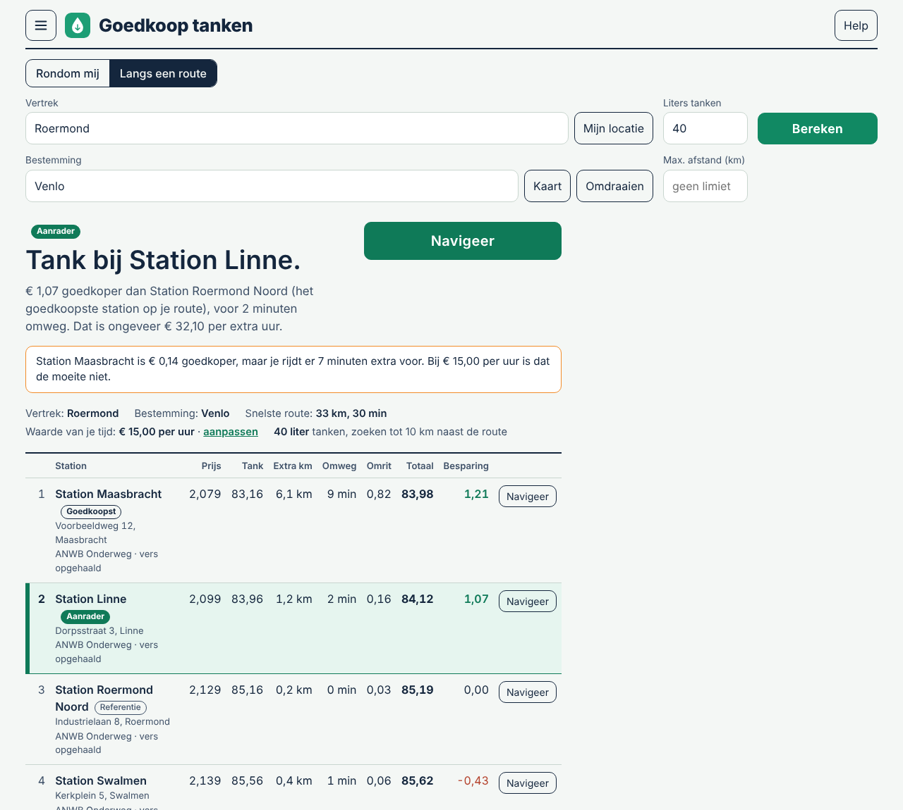
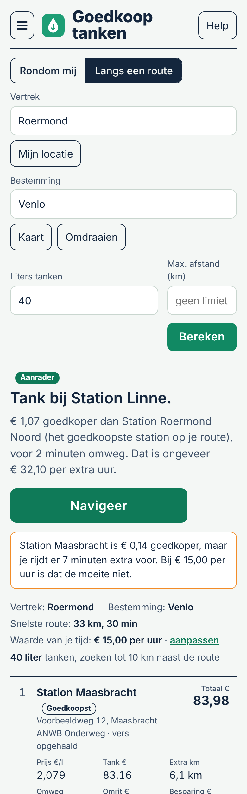

# Home Assistant-add-on: Goedkoop tanken

Vindt het **goedkoopste tankstation inclusief de kosten van de omrit en de extra rijtijd**, in Nederland, Duitsland en België.
Een lage literprijs is niets waard als het station ver uit de buurt ligt. Deze app rekent per station uit wat tanken je
in totaal kost en geeft één duidelijke **aanrader**.

*Voorbeeldgegevens; de stations en prijzen in deze afbeelding zijn verzonnen.*

## Wat kan het?

- **Rondom mij:** waar tank ik het voordeligst vanaf hier? Het dichtstbijzijnde station is het uitgangspunt.
- **Langs een route:** waar tank ik onderweg van A naar B (bijvoorbeeld van huis naar werk)? Alleen de omweg telt als extra.
- **Aanrader:** het station met de laagste kosten inclusief je tijd. Wat een uur van je tijd waard is (standaard € 15) stel je zelf in.
- **Navigeer** met één tik naar Google Maps, Apple Maps of Waze.
- **Kaart, berekening per station** en alle bekeken stations als download, zodat je kunt nagaan hoe een uitkomst tot stand komt.
- **Vaste adressen** (werk, school, familie) als bestemming, en je telefoon als locatie via Home Assistant.
- **Help** in de app (knop rechtsboven) legt het gebruik en alle instellingen uit.

## Snel starten

1. Open **Goedkoop tanken** in de zijbalk.
2. Open het menu (linksboven) en vul je thuisadres en kenteken in. Voor Duitse prijzen heb je een gratis
   Tankerkönig-sleutel nodig (zie [DOCS.md](DOCS.md)).
3. Kies *Rondom mij* of *Langs een route*, vul het aantal liters in en kies **Bereken**.

Zie [DOCS.md](DOCS.md) voor het volledige gebruik en de privacy-informatie. Licentie: GPL v3.

*Let op: dit is een testversie (0.x). De ANWB-bron voor Nederland en België is niet officieel en kan zonder bericht veranderen.*
